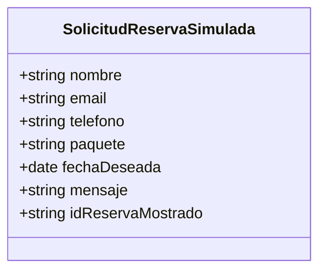

# Análisis de entidad, operaciones CRUD y seguridad

## Descripción breve del sistema

Lumina Studio es una aplicación React de una sola página que presenta un estudio de fotografía. Permite recorrer una galería, consultar paquetes y completar una solicitud de reserva. El formulario muestra una confirmación simulada, pero no envía ni conserva la información introducida. No se identifican backend, base de datos, rutas, autenticación ni roles en el proyecto inspeccionado.

## Entidad principal

La entidad principal se modela aquí como **Solicitud de reserva (simulada)**. Se elige porque el formulario de contacto invita al usuario a solicitar una fecha y reúne los datos asociados a esa intención (`src/components/Booking.jsx:29-61`). No existe una definición de modelo persistente: los campos se identifican por los controles del formulario y no como un objeto de dominio guardado.

| Campo | Tipo de dato | Descripción | Obligatorio | Sensible |
|---|---|---|---|---|
| nombre | Texto | Nombre de quien solicita la reserva. | Sí (`required`) | Dato personal identificable. |
| email | Cadena con formato de correo | Medio de contacto; el control `type="email"` ofrece validación básica del navegador. | Sí (`required`) | Dato personal de contacto. |
| teléfono | Texto (`tel`) | Número de contacto. | No especificado como obligatorio (sin `required`). | Dato personal de contacto. |
| paquete | Texto; conjunto de opciones derivado de catálogo | Paquete de interés seleccionado; opciones Esencial, Premium o Eventos. | No (hay opción vacía). | No, por sí solo. |
| fecha deseada | Fecha (`date`) | Fecha solicitada; el control establece como mínimo la fecha actual en el navegador. | Sí (`required`) | Puede revelar planes personales; sensibilidad contextual. |
| mensaje / detalles del proyecto | Texto multilínea | Descripción libre de la solicitud. | Sí (`required`) | Puede contener información personal o confidencial; contenido no restringido. |
| ID de reserva mostrado | Texto | Código `LUM-` más cuatro dígitos aleatorios; se genera al enviar el formulario y se presenta como simulación. | No aplica | No es credencial ni identificador persistente; colisiones posibles. |

Los tipos y restricciones anteriores se infieren de los elementos HTML. No se especifican longitudes máximas, formato telefónico, política de retención, validación de negocio ni esquema de datos. El identificador no corresponde a un registro real (`src/components/Booking.jsx:5-12, 19-24`).

## Matriz CRUD y permisos

No hay roles ni identidad de usuario implementados. Por tanto, la columna indica una **propuesta** para un futuro sistema con backend, no permisos existentes. La interfaz pública permite a cualquier visitante operar el formulario, pero eso no equivale a autorización. No hay controles de acceso efectivos que el código inspeccionado permita verificar.

| Entidad o dato | Crear | Leer | Actualizar | Eliminar |
|---|---|---|---|---|
| Solicitud de reserva y campos de contacto | Visitante, mediante formulario (simulado); propuesta: cliente no autenticado puede enviar una solicitud validada | Propuesta: propietario de la solicitud y personal autorizado; visitante solo lee su confirmación de envío | Propuesta: propietario autenticado y personal autorizado, con verificación en servidor | Propuesta: personal autorizado; propietario solo mediante flujo verificado y política de retención |
| Paquetes (nombre, precio y características) | No disponible en interfaz; propuesta: administrador | Visitante, desde catálogo estático | No disponible en interfaz; propuesta: administrador | No disponible en interfaz; propuesta: administrador |

**Estado de operaciones:** la interfaz recoge nombre, correo, teléfono, paquete, fecha y mensaje, pero `submitBooking` no lee los valores del formulario: solo evita el envío HTML y cambia estado para mostrar un código aleatorio (`src/components/Booking.jsx:9-12, 29-61`). No hay creación, lectura, actualización o eliminación de solicitudes como registros. El paquete seleccionado sí se refleja en estado React y se comparte entre precios y formulario (`src/App.jsx:10-16, 25-26`), pero es solo estado en memoria. Los paquetes y la galería son datos estáticos importados desde `src/data/siteContent.js:1-45`. No aparecen llamadas de red ni uso de almacenamiento persistente en el código de aplicación inspeccionado.

## Regla de seguridad indispensable

**Regla:** cualquier solicitud que llegue a almacenarse o consultarse debe ser accesible únicamente a su titular y al personal con autorización explícita; toda autorización debe imponerse en el servidor, y el contenido libre del mensaje debe tratarse como entrada no confiable.

Es indispensable porque el formulario solicita datos de contacto y texto libre (`src/components/Booking.jsx:31-59`). Hoy no existe backend ni almacenamiento, por lo que no se demuestra una exposición de registros ni se puede comprobar control de acceso. Tampoco existe autorización efectiva: no hay autenticación o roles identificables; las comprobaciones `required`, `type="email"` y `min` son validaciones de interfaz y no controles de seguridad del servidor. En el escenario futuro de persistencia, una API que confiara en identificadores o permisos enviados por el cliente podría permitir lectura o modificación indebida.

Al incorporar backend, autenticar las operaciones de consulta y cambio, comprobar en cada solicitud que el usuario sea titular o tenga un permiso administrativo, validar y limitar los datos en servidor, y devolver al cliente solo los campos necesarios. Para solicitudes públicas de creación, aplicar controles antiabuso y almacenar el mínimo de información requerido con una política de retención definida.

## Duda técnica y respuesta

**Pregunta:** ¿Puede una persona consultar o alterar las solicitudes de otros usuarios usando el identificador de reserva que muestra el formulario?

**Respuesta:** en la versión inspeccionada no hay solicitudes guardadas ni una operación de consulta o modificación, así que no se puede demostrar ese acceso indebido como vulnerabilidad actual. El código genera el identificador con `Math.random()` y un espacio de solo 10 000 sufijos (`src/components/Booking.jsx:9-12`); no hay unicidad ni asociación a un registro. Se anuncia como confirmación de simulación (`src/components/Booking.jsx:19-24`), por lo que no debe usarse como token de acceso. Si en una futura implementación se aceptara este valor como única prueba de autorización, sería un riesgo potencial: el espacio es enumerable y puede haber colisiones.

**Recomendación:** no autorizar acceso por un código visible al cliente. En backend, aplicar autorización por titular y rol en cada operación; si se necesita un enlace de seguimiento sin sesión, usar un token criptográficamente aleatorio de alta entropía, almacenarlo de forma segura, limitar su alcance y permitir revocación. Validar también fecha y paquete contra reglas del servidor.

## Conclusión

El proyecto implementa una experiencia visual y un formulario de reserva demostrativo, no un sistema CRUD de reservas. Los datos personales introducidos no se recogen en un objeto de estado ni se transmiten o persisten por el manejador actual; no se debe interpretar la confirmación como reserva real. Antes de producción, se requiere definir el modelo y ciclo de vida de la solicitud, minimizar y proteger los datos personales, e implementar autenticación/autorización y validación en un backend. El análisis se limita al código disponible en este workspace; no permite afirmar cómo se comportaría un servicio externo futuro.

## Referencias del proyecto

- `react-app/package.json:6-18` — scripts y dependencias; no incluye cliente de backend identificado.
- `react-app/src/App.jsx:10-28` — composición de la página y estado de paquete en memoria.
- `react-app/src/components/Booking.jsx:5-12, 29-61` — estado de confirmación simulada, campos y manejador del formulario.
- `react-app/src/data/siteContent.js:28-45` — catálogo estático de paquetes.
- `react-app/src/components/Pricing.jsx:1-24` — presentación y selección de paquetes.

