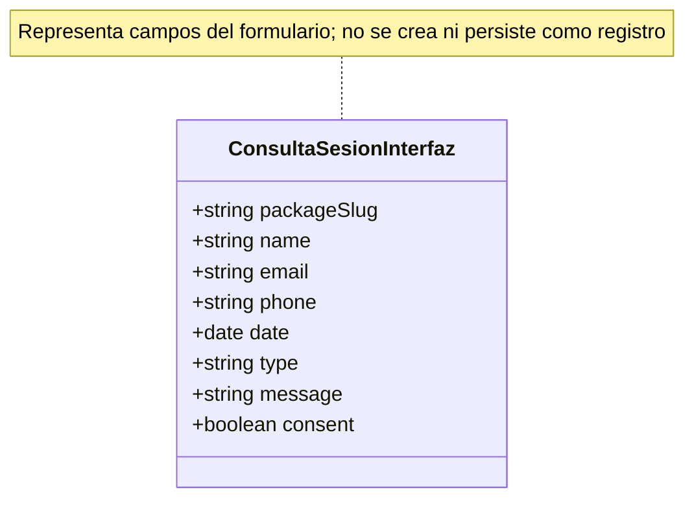

# Análisis de entidad, operaciones CRUD y seguridad

## Descripción breve del sistema

Lumina Studio es un sitio React para presentar un estudio fotográfico, su galería y tres paquetes de servicio. La navegación se realiza con rutas en el fragmento de URL (`#`) y el contenido del catálogo está definido estáticamente en el cliente. Desde cada paquete se puede abrir un formulario para expresar interés en una sesión. El formulario es demostrativo: no hay backend ni base de datos y la consulta no se envía ni se guarda.

## Entidad principal

### Consulta de sesión

La entidad principal se define para el análisis como **Consulta de sesión**. Es la unidad de negocio más relevante porque conecta el paquete que el visitante consulta con sus datos de contacto, fecha y descripción del proyecto (`src/pages/BookingPage.jsx:15-50`). Sin embargo, el código no crea un objeto de consulta ni un registro persistente; el modelo siguiente describe los campos que la interfaz solicita, no una entidad almacenada.

| Campo | Tipo de dato | Descripción | Obligatorio | Sensible |
|---|---|---|---|---|
| paquete (`packageSlug`) | Cadena; uno de los slugs definidos en el catálogo | Se obtiene de la ruta `#/reservar/{slug}` y determina el paquete mostrado. No es un campo editable del formulario. | Requerido para identificar una página de paquete válida; no se valida como parte del envío. | No, por sí solo. |
| nombre (`name`) | Texto | Nombre completo escrito por el visitante. | Sí (`required`); máximo 100 caracteres en el control. | Dato personal identificable. |
| correo electrónico (`email`) | Cadena con formato de correo | Dirección para responder la consulta. | Sí (`required`, `type="email"`); máximo 254 caracteres en el control. | Dato personal de contacto. |
| teléfono (`phone`) | Texto (`tel`) | Teléfono opcional de contacto. | No. Máximo 30 caracteres en el control. | Dato personal de contacto. |
| fecha de interés (`date`) | Fecha (`date`) | Fecha deseada para la sesión. El control fija como mínimo la fecha local actual. | Sí (`required`). | Dato personal contextual; puede revelar planes. |
| tipo de sesión (`type`) | Cadena; selección de opciones fijas | Tipo indicado por el visitante: boda, retrato, evento, proyecto editorial u otro. | No; la opción inicial es vacía. | No, por sí solo. |
| mensaje (`message`) | Texto multilínea | Descripción libre del proyecto; el visitante puede incluir información personal no prevista. | Sí (`required`); máximo 1200 caracteres en el control. | Puede contener datos personales o confidenciales. |
| consentimiento (`consent`) | Booleano inferido de casilla | Casilla requerida con la que el visitante autoriza el uso de sus datos para responder la consulta. No tiene `name` ni se guarda. | Sí para completar el envío del formulario (`required`). | Preferencia/dato relacionado con privacidad. |

Los límites HTML y tipos se basan en los controles, pero no son validación de servidor. `packageSlug` es una inferencia derivada de la ruta y de la búsqueda en el catálogo (`src/App.jsx:25-28, 54-64`, `src/pages/BookingPage.jsx:8`). El estado `demoMessage` solo controla la presentación del aviso tras el envío; no constituye un estado de consulta guardada (`src/pages/BookingPage.jsx:5, 36-37`). La casilla de consentimiento es `required`, pero carece de `name`; además, el manejador no lee los valores ni construye un payload (`src/pages/BookingPage.jsx:37-50`).

## Matriz CRUD y permisos

No se implementan roles, cuentas, autenticación ni autorización. Para hacer explícita la matriz se proponen, solo para un futuro backend, dos perfiles: **Visitante** (persona no autenticada que puede enviar una consulta) y **Personal autorizado** (cuenta autenticada del estudio con permisos operativos). No son roles existentes. La interfaz pública permite consultar el catálogo y rellenar el formulario, pero eso no demuestra ni sustituye autorización de servidor.

| Entidad o dato | Crear | Leer | Actualizar | Eliminar |
|---|---|---|---|---|
| Consulta de sesión (nombre, correo, teléfono, fecha, tipo y mensaje) | Visitante público mediante formulario; actualmente solo simulación. Propuesta: aceptar solicitudes públicas con validación, límites antiabuso y consentimiento informado. | Actualmente no existe lectura de registros. Propuesta: personal autorizado; el titular solo mediante canal verificado si se habilita consulta. | Actualmente no existe actualización. Propuesta: personal autorizado; permitir al titular corregir datos tras verificar identidad. | Actualmente no existe eliminación. Propuesta: personal autorizado según retención; tramitar solicitudes del titular tras verificar identidad. |
| Paquete asociado (`packageSlug`) | No se crea un registro. Propuesta: asignarlo desde el catálogo validado en servidor, no confiar en precio o slug arbitrario del cliente. | Visitantes leen la descripción pública del paquete en el catálogo estático. | Sin edición en interfaz; propuesta: administrador autorizado. | Sin eliminación en interfaz; propuesta: administrador autorizado, preservando integridad de consultas históricas. |
| Consentimiento | La casilla se marca en el navegador; no se registra. Propuesta: guardar evidencia verificable del consentimiento junto a la consulta, su propósito y versión del aviso. | No hay registro consultable. Propuesta: personal autorizado y titular mediante solicitud verificada. | No implementado. Propuesta: no alterar retrospectivamente la evidencia; registrar cambios/revocaciones como eventos. | No implementado. Propuesta: aplicar política de retención y obligaciones de privacidad en servidor. |
| Paquetes y galería | No disponible; catálogo y enlaces de fotos son estáticos. Propuesta: administrador autorizado si se añade gestión. | Público, desde `src/data/siteContent.js`. | No disponible en interfaz. Propuesta: administrador autorizado. | No disponible en interfaz. Propuesta: administrador autorizado. |

**Operaciones actuales:** el navegador presenta los paquetes y las imágenes como contenido de solo lectura. El formulario aplica restricciones de interfaz (`required`, `type`, `maxLength`, fecha mínima y casilla obligatoria); su `onSubmit` llama `preventDefault()` y cambia `demoMessage`, sin leer valores, crear un objeto, transmitir una petición ni escribir almacenamiento (`src/pages/BookingPage.jsx:37-50`). La selección del paquete proviene de un slug cotejado con el catálogo (`src/App.jsx:54-64`, `src/data/siteContent.js:10-23`). La única persistencia del navegador encontrada es `localStorage` para recordar el tema visual (`src/App.jsx:30-37`); no guarda datos de consultas. No se encontraron llamadas `fetch`/Axios, `sessionStorage`, modelos persistentes, operaciones CRUD de consultas, roles o autenticación en el flujo activo.

El componente `Legacy/components/Booking.jsx:1-24` conserva un flujo de reserva simulado antiguo que generaba un ID aleatorio, pero `src/App.jsx:1-7, 54-64` no lo importa ni lo renderiza. Por tanto, no forma parte del flujo activo y su ID no es un registro de reserva.

## Regla de seguridad indispensable

**Regla:** la información personal de una consulta solo debe transmitirse y almacenarse con un propósito informado y acceso limitado al titular y al personal autorizado; las comprobaciones y permisos deben imponerse en el servidor, no depender del frontend.

**Justificación y relación con el código.** El formulario solicita nombre, correo, teléfono, fecha y detalles libres del proyecto, además de una casilla que declara autorización de uso (`src/pages/BookingPage.jsx:39-48`). El mensaje libre puede contener datos que el estudio no necesita. El código no captura ni transmite esos valores: el manejador solo cancela el envío HTML y muestra un aviso que confirma que no se guardaron datos (`src/pages/BookingPage.jsx:36-37, 50`). Por ello, no se demuestra exposición de registros almacenados ni existe una operación de autorización de datos que pueda probarse.

**Estado actual:** no existe procesamiento de consultas en servidor que permita comprobar autorización de acceso. En el flujo visible, los valores no se guardan ni envían; por ello no se confirma exposición ni acceso indebido a registros. La casilla no genera evidencia de consentimiento: es obligatoria para la validación del navegador, pero no tiene `name`, no se lee ni se registra. Tampoco se enlaza a un aviso de privacidad. Las validaciones del navegador pueden omitirse y no son controles de seguridad de servidor.

**Implementación recomendada:** si se conecta un backend, validar en servidor los campos, el paquete y sus reglas; minimizar datos y limitar longitud/tipo; registrar el consentimiento informado junto a la consulta; proteger cada lectura, modificación y eliminación con autorización por titular/rol en cada petición; definir retención y eliminación; y no recoger datos de pago en este formulario. No almacenar datos sensibles en almacenamiento del navegador como sustituto de controles del servidor.

## Duda técnica y respuesta

**Pregunta:** ¿Puede el estudio demostrar que el visitante aceptó el uso de sus datos y limitar quién accede a la consulta si se añade persistencia al formulario actual?

**Respuesta:** no con la implementación actual. La casilla requerida solo participa en la validación del navegador, pero no tiene atributo `name`, no se lee y no se almacena (`src/pages/BookingPage.jsx:48-50`). El manejador tampoco recopila los valores (`src/pages/BookingPage.jsx:37`). No existe backend, cuenta autenticada, rol ni CRUD de consultas que pueda restringir el acceso. Así, no hay una vulnerabilidad confirmada de lectura de registros —no se crean—, pero sí un **riesgo potencial y una regla de privacidad incompleta** si luego se persisten consultas sin evidencia de consentimiento ni control de accesos.

**Recomendación concreta:** enviar una estructura validada a un servicio backend mediante HTTPS; asociar el consentimiento con fecha, propósito y versión del aviso; aplicar autorización en el servidor en cada lectura/cambio y filtrar la respuesta a los campos necesarios. Mantener la solicitud sin campos de tarjeta y usar un proveedor de pagos separado si esa función se incorpora.

## Conclusión

La aplicación implementa navegación, catálogo público y un formulario demostrativo, no un sistema CRUD de consultas. Los datos introducidos no se envían ni guardan, y no hay autenticación o roles; por ello, no corresponde afirmar que exista acceso indebido confirmado a registros. Antes de recibir solicitudes reales se debe definir el tratamiento de datos y el consentimiento, validar en servidor y limitar el acceso por titular y personal autorizado. La galería y los paquetes son contenido estático y público; el análisis se limita al código disponible en el workspace.

## Referencias

- `package.json:6-18` — scripts y dependencias React/Vite; no se identifica una dependencia de API de negocio.
- `src/main.jsx:1-10` — montaje de React.
- `src/App.jsx:25-64` — enrutamiento por hash, selección del paquete y composición de páginas activas.
- `src/App.jsx:30-37` — preferencia de tema guardada en `localStorage`; no corresponde a datos de negocio.
- `src/pages/BookingPage.jsx:4-55` — campos de consulta, restricciones de navegador, consentimiento y manejador simulado.
- `src/data/siteContent.js:1-23` — fuentes estáticas de galería y atributos del catálogo de paquetes.
- `src/pages/HomePage.jsx:50-68` — lectura pública y enlaces de consulta de los tres paquetes.
- `src/pages/GalleryPage.jsx:20-39` — galería pública con datos estáticos e imágenes servidas desde Pexels.
- `Legacy/components/Booking.jsx:1-24` — componente antiguo no importado por la aplicación activa; confirmación simulada.

